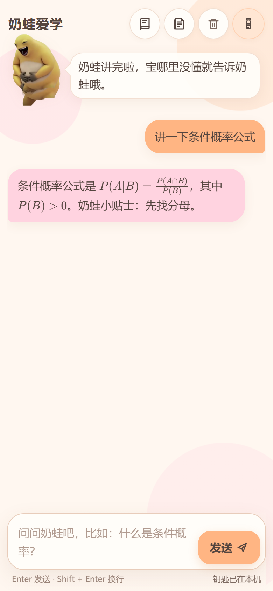

# 奶蛙爱学 · AI 学习搭子

一个可以直接打开使用的 AI 学习陪伴单页应用。

## 功能

- 奶蛙 AI 学习搭子：讲知识点、规划复习、苏格拉底式引导
- 错题本：收录题目、解析、笔记、掌握状态，支持随堂小测
- 答对播放奶蛙笑声，可在设置或小测提示条里关闭
- 思考强度：自动 / 关闭 / 轻 / 标准 / 深度（DeepSeek thinking mode）
- 知识库：Word、PDF、图片 OCR、纯文本；文档库目标 512 MB（IndexedDB）
- LaTeX 公式：KaTeX 与字体已内嵌，断网也能渲染
- 手机端头像静态 PNG 回退，不依赖外部图片

## 直接打开

双击或用浏览器打开根目录的 `index.html` 即可。

第一次进入需要点「去设置钥匙」，填写自己的 DeepSeek API Key（或任意 OpenAI 兼容接口的 Key / Base URL / 模型名），然后保存。

## 发到 GitHub Pages

1. 在 GitHub 新建一个仓库（可以设为 Public 或 Private）。
2. 把本文件夹里的所有文件上传到仓库根目录，保证 `index.html` 在根目录。
3. 进入仓库 **Settings → Pages**。
4. **Build and deployment** 选择 **Deploy from a branch**，Branch 选 `main`，目录选 `/ (root)`，保存。
5. 等一两分钟，访问 `https://<你的用户名>.github.io/<仓库名>/`。

这个页面是纯静态的，不需要安装依赖、不需要构建命令。

## 隐私与安全

- 没有后端服务器，API Key、聊天记录、错题本都只保存在当前浏览器的本地存储里。
- 仓库源码里**没有 API Key**；发布到 GitHub 不会把本机浏览器里保存的 Key 一起带上去。
- 如果不想保留本机记录，可以在应用里清空对话/错题本，或清除浏览器站点数据。
- 换浏览器、换设备或清除站点数据后，本地记录不会自动同步。
- Word/PDF/图片 OCR 的解析插件和 OCR 语言包第一次使用时需要联网加载；聊天本身也需要 API 和网络。
- 角色图片、笑声和参考素材来自网络，版权归原作者；详细来源见 [NOTICE.md](NOTICE.md)。公开发布/商用前请自行确认授权，或替换为原创素材。

## 文件

- `index.html`：完整应用（样式、图片、声音、公式库都已内嵌）
- `assets/icon.png`：站点图标
- `screenshot.png`：界面截图
- `NOTICE.md`：第三方素材与开源库说明
